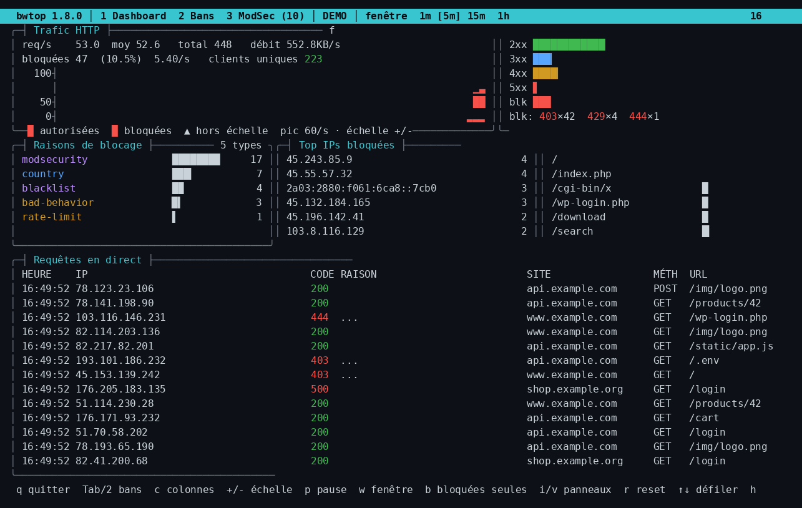

# bwtop



> ⚠️ **Projet intégralement « vibecodé » par Claude (Anthropic).**
> De la première ligne au dépôt que tu lis, tout le code, les tests et cette
> documentation ont été écrits par Claude au fil d'une conversation, à partir
> des idées et des retours de terrain de l'utilisateur. Considère-le comme tel :
> relis-le avant de l'utiliser en production.

**bwtop** est un tableau de bord **temps réel en terminal** (curses) pour
[BunkerWeb](https://www.bunkerweb.io/), à la manière de `htop` / `btop`. Il
affiche le trafic HTTP, les requêtes bloquées et **leur raison**, gère les
**bans** (y compris l'unban CrowdSec), et permet de corriger les **faux
positifs ModSecurity** en direct — l'équivalent open source d'une fonction
réservée à BunkerWeb PRO.

Aucune dépendance : **Python 3.8+** et le module standard `curses`. Un script
de build produit un **binaire autonome** (PyInstaller) qui tourne sans Python
installé sur la machine cible.

---

## Sommaire

- [Aperçu des fonctionnalités](#aperçu-des-fonctionnalités)
- [Installation](#installation)
- [Premier démarrage (assistant)](#premier-démarrage-assistant)
- [Sources de logs](#sources-de-logs)
- [Les trois vues](#les-trois-vues)
- [Exclusions ModSecurity (faux positifs)](#exclusions-modsecurity-faux-positifs)
- [Bans & CrowdSec](#bans--crowdsec)
- [Diagnostic : `--selftest`](#diagnostic---selftest)
- [`bwtest` : valider que le WAF bloque](#bwtest--valider-que-le-waf-bloque)
- [Fichiers de configuration](#fichiers-de-configuration)
- [Référence des options](#référence-des-options)
- [Comment ça marche (interne)](#comment-ça-marche-interne)
- [Licence](#licence)

---

## Aperçu des fonctionnalités

- **Trafic HTTP temps réel** : req/s instantané et moyen, débit, codes HTTP
  (2xx/3xx/4xx/5xx), graphe empilé à **échelle fixe** (autorisées en vert,
  bloquées en rouge), fenêtres 1 m / 5 m / 15 m / 1 h.
- **Requêtes bloquées + raison** : la raison du blocage (ModSecurity,
  blacklist, bad-behavior, rate-limit, antibot, country, CrowdSec, DNSBL…) est
  déduite de l'`error.log` par corrélation IP + horodatage, et la règle CRS
  précise (ex. `942100 SQL Injection…`) est affichée.
- **Flux en direct** avec **colonnes configurables** (heure, IP, code, raison,
  site, méthode, taille, user-agent, URL), largeur et ordre réglables.
- **Filtre global par service** (`/`) : restreint l'ensemble du tableau de bord
  à un seul site, avec auto-complétion des services vus et bandeau d'état.
- **Graphes système** optionnels (`S`) : CPU (moyenne + historique), RAM et
  débit réseau (up/down) de la machine locale, lus dans `/proc` sans dépendance.
- **Vue Bans** : liste les bans actifs (portée, site, raison, date, temps
  restant, pays), **unban** d'un ban ou de toutes les portées d'une IP,
  filtre et tri.
- **Unban CrowdSec** optionnel : supprime aussi les décisions CrowdSec via
  `cscli`, dans le bon ordre et de façon fail-safe.
- **Vue ModSec** : déclenchements groupés par host + règle, détail des IP
  concernées (avec horodatages), et surtout **whitelist d'un faux positif en
  direct** — par service, écrit soit via l'API bunkerweb-api (éditable dans
  l'UI), soit en fichier `.conf`.
- **Assistant de configuration** (`--setup`) et **diagnostic complet**
  (`--selftest`) qui teste tous les prérequis et l'application réelle sur tous
  les services.
- **Multi-sites**, **IPv4/IPv6**, fonctionne en **natif Linux** comme en
  **Docker**.

---

## Installation

### Binaire autonome (recommandé)

Sur une machine de **même architecture / glibc** que la cible (idéalement le
serveur BunkerWeb lui-même) :

```bash
git clone https://github.com/Kn-ut99/bwtop.git
cd bwtop
./build.sh            # crée dist/bwtop via PyInstaller
sudo install -m 0755 dist/bwtop /usr/local/bin/bwtop
```

### Sans compiler

`bwtop` est un script Python exécutable sans aucune dépendance externe :

```bash
sudo ./bwtop            # ou: sudo python3 ./bwtop
```

> `sudo` est nécessaire pour lire `/var/log/bunkerweb/*.log`, les
> `variables.env` et, le cas échéant, écrire les configs ModSec / appeler
> `cscli`.

---

## Premier démarrage (assistant)

Au tout premier lancement dans un terminal interactif, bwtop lance
automatiquement un **assistant** qui :

1. détecte l'environnement (root, `variables.env`, **présence de CrowdSec**) ;
2. te demande le **backend d'exclusion ModSec** : API bunkerweb-api ou fichier ;
3. en mode API, teste la connexion et enregistre le token (`/etc/bwtop/bwtop.env`, droits `0600`) ;
4. si CrowdSec est détecté, demande ton **consentement** pour activer la suppression des décisions lors d'un unban ;
5. propose de lancer une vérification complète.

Tu peux le relancer à tout moment (ex. CrowdSec installé après coup) :

```bash
sudo bwtop --setup        # alias : --reconfigure, --wizard
```

L'auto-lancement est désactivé hors terminal interactif (pipe, cron,
`--docker`, `--demo`).

---

## Sources de logs

```bash
sudo bwtop                                   # /var/log/bunkerweb/{access,error}.log
sudo bwtop -a /chemin/access.log -e /chemin/error.log
bwtop --docker bunkerweb                     # docker logs -f (access + error)
ssh srv 'docker logs -f bunkerweb 2>&1' | bwtop -   # stdin
bwtop --demo                                 # trafic + bans synthétiques
```

Le format par défaut est le `LOG_FORMAT` de BunkerWeb (qui contient `$host`),
l'ancien format et le `combined` nginx. Pour un format personnalisé :
`--access-regex` avec les groupes nommés `host`, `ip`, `time`, `status`.

---

## Les trois vues

Bascule avec `Tab` ou les touches `1` / `2` / `3`. `h` ouvre l'aide, `q` quitte.

### 1 — Dashboard
`p` pause · `w` fenêtre (1 m→5 m→15 m→1 h) · `b` bloquées seulement ·
`/` **filtrer tout le tableau sur un service** · `S` **graphes système** ·
`n` interface réseau · `c`/`F2` colonnes · `+`/`-` échelle du graphe ·
`i`/`v` panneaux · `r` reset · `↑↓ PgUp/PgDn` défiler.

Le filtre `/` applique un **filtre global par service** : tout le tableau de
bord (compteurs, codes, raisons, graphe, flux) ne reflète alors que le service
choisi. La saisie est **auto-complétée** avec les services vus dans la fenêtre
de temps active (`↹` pour parcourir les propositions), sans bloquer la frappe
si aucun trafic n'a encore été vu — on peut valider un nom au clavier avec
`Entrée`. Le service actif s'affiche dans un **bandeau bien visible** en haut
de l'écran ; `Échap` (ou `/` puis `Entrée` à vide) retire le filtre.

La touche `S` affiche/masque une **rangée de graphes système** (lus dans
`/proc`, sans dépendance) : **CPU** (charge moyenne + historique), **RAM**, et
**débit réseau** (montée/descente). Ces graphes mesurent la machine
**qui exécute bwtop** (en
général le serveur BunkerWeb lui-même). L'interface réseau est par défaut celle
de la **route par défaut** ; `n` passe d'une interface physique à l'autre (les
interfaces virtuelles `lo`/`docker*`/`veth*`/`br-*` sont ignorées), ou on la fixe
avec `--net-iface eth0`. L'état (affiché/masqué) et l'interface choisie sont
mémorisés dans `config.json`.

### 2 — Bans
`↑↓` choisir · `u` débannir · `U` débannir l'IP partout ·
`C` activer/désactiver l'unban CrowdSec · `/` filtrer · `s` tri · `r` rafraîchir.

### 3 — ModSec (faux positifs)
`↑↓` choisir · `Entrée` détail des IP + horodatages ·
`w` whitelister / réactiver la règle pour le host · `g` portée globale ·
`/` filtrer · `s` tri · `r` rafraîchir.

---

## Exclusions ModSecurity (faux positifs)

Certains services (Authentik, etc.) déclenchent des faux positifs du Core Rule
Set. L'onglet ModSec liste les règles qui se déclenchent, et `w` crée une
**exclusion par service** sans quitter l'outil. Deux backends :

### Mode API (recommandé) — `--exclusions-backend api`
Écrit l'exclusion via le plan de contrôle **bunkerweb-api** (`POST /configs`,
type `modsec`). Avantages : appliqué automatiquement par le scheduler (pas de
redémarrage), et l'exclusion est **visible et éditable dans l'UI** (méthode
`api`).

```bash
# enregistrer le token une fois (API_TOKEN de /etc/bunkerweb/api.env)
sudo bwtop --save-api-token \
  --config-api-url http://127.0.0.1:8888 \
  --config-api-token "<ton_jeton>"
# ensuite, le mode auto choisit l'API
sudo bwtop
```

### Mode fichier — `--exclusions-backend file`
Écrit `/etc/bunkerweb/configs/modsec/<service>/bwtop_fp_<règle>_<service>.conf`
puis **redémarre le scheduler** (`systemctl restart bunkerweb-scheduler`).

> ⚠️ Un simple `systemctl reload` **ne réimporte pas** les fichiers posés à la
> main : le scheduler régénère le dossier depuis la base et l'efface. bwtop
> utilise donc `restart`, qui déclenche le scan d'import au démarrage. Le
> redémarrage du scheduler **n'interrompt pas** le trafic (nginx est un service
> séparé).

**Sélection automatique (`auto`, défaut)** : API si un token est disponible
(`bwtop.env`), sinon fichier + restart.

Les exclusions créées par bwtop sont nommées `bwtop_fp_*` et **réversibles** :
re-sélectionner une règle whitelistée propose de la réactiver. Une vérification
différée (6 s) alerte si le scheduler a rejeté l'exclusion.

---

## Bans & CrowdSec

La vue Bans lit les bans via l'API interne de BunkerWeb (la même que `bwcli`),
dont l'adresse, le `Host` et le jeton sont lus dans `variables.env`.

- `u` lève le ban sélectionné, `U` toutes les portées d'une IP.
- `--unban-via bwcli` propage l'unban à toutes les instances (multi-instances).
- `--bans-api central` utilise le service bunkerweb-api au lieu de l'API interne.

**Unban CrowdSec** (touche `C`, ou `--crowdsec-unban`) : supprime en plus les
décisions CrowdSec via `cscli decisions delete`, après un aperçu des décisions
concernées. Comportement **fail-safe** : si `cscli` échoue ou qu'il reste des
décisions actives (plage, origine CAPI/listes), la copie BunkerWeb du ban est
**conservée** — l'IP n'est jamais laissée dans un état incohérent.
`--cscli "docker exec crowdsec cscli"` si CrowdSec tourne en conteneur.

---

## Diagnostic : `--selftest`

Diagnostic complet, non interactif, qui vérifie **tous les prérequis** et teste
l'application réelle des exclusions **sur tous les services détectés** :

```bash
sudo bwtop --selftest              # complet (écrit un témoin + reload, puis nettoie)
sudo bwtop --selftest --no-apply-test   # lecture seule
```

Il contrôle : root, terminfo, `variables.env`, lisibilité des logs,
joignabilité de l'API des bans, présence de `cscli`, backend d'exclusion
choisi, **liste des services avec leur état ModSec (ON/OFF)**, et confirme que
l'écriture d'une exclusion est bien prise en compte service par service. Code
de sortie non nul s'il y a un problème (utile en script/CI).

---

## `bwtest` : valider que le WAF bloque

Outil compagnon (`bwtest`, livré dans ce dépôt) qui envoie une batterie de
**signatures d'attaque inoffensives** (SQLi, XSS, traversée, RCE, scanners…)
contre **ton** site et vérifie que chacune est bloquée (403/429/444).

```bash
./bwtest https://ton-site.fr          # lancer depuis ton réseau
```

À utiliser uniquement sur un site que tu possèdes/es autorisé à tester. Lance
`bwtop` en parallèle pour voir les blocages apparaître en direct.

---

## Fichiers de configuration

| Fichier | Rôle | Droits |
|---|---|---|
| `~/.config/bwtop/config.json` | préférences (colonnes, échelle du graphe, unban CrowdSec, graphes système + interface réseau, marqueur d'installation) | 0644 |
| `/etc/bwtop/bwtop.env` (ou `~/.config/bwtop/bwtop.env`) | accès au plan de contrôle : `CONFIG_API_URL`, `CONFIG_API_TOKEN` | **0600** |

Sous `sudo`, le `config.json` est écrit dans le home de l'utilisateur d'origine.
Les secrets restent dans `bwtop.env` (0600), jamais dans `config.json`.

---

## Référence des options

### Général
| Option | Description |
|---|---|
| `source` | `-` pour lire les logs sur stdin |
| `-a, --access` | access.log (défaut `/var/log/bunkerweb/access.log`) |
| `-e, --error` | error.log (raisons des blocages) |
| `--docker CONTENEUR` | suit `docker logs -f` (access + error) |
| `--demo` | trafic + bans synthétiques |
| `--backlog N` | lignes d'historique relues par fichier (défaut 5000) |
| `--block-status` | codes « bloqué » (défaut `403,429,444`) |
| `--access-regex` | regex perso (groupes `host,ip,time,status,…`) |
| `--dump-unmatched F` | journalise les lignes d'erreur sans raison reconnue |
| `--keep-internal` | ne pas ignorer les health-checks internes (`bwapi`) |
| `--graph-max REQ_S` | échelle fixe du graphe en req/s |
| `--sys-graphs` | affiche d'emblée les graphes système (sinon touche `S`) |
| `--net-iface IFACE` | interface réseau pour le graphe de débit (défaut : route par défaut) |
| `--setup` / `--reconfigure` / `--wizard` | (re)lance l'assistant |
| `--config FICHIER` | chemin du config.json |
| `--no-color` | désactive la couleur |
| `-V, --version` | version |

### Bans
| Option | Description |
|---|---|
| `--no-bans` | désactive la vue Bans |
| `--bans-api {instance,central}` | API interne (défaut) ou bunkerweb-api |
| `--bans-url` / `--bans-host` / `--bans-token` | surcharge URL / Host / jeton |
| `--bans-interval N` | rafraîchissement des bans (défaut 5 s) |
| `--unban-via {api,bwcli}` | unban via API (défaut) ou `bwcli` (multi-instances) |
| `--insecure` | ne pas vérifier le TLS |
| `--crowdsec-unban` | démarre avec l'unban CrowdSec activé |
| `--cscli CMD` | commande cscli (ex. `docker exec crowdsec cscli`) |
| `--no-crowdsec` | désactive l'unban CrowdSec |

### Exclusions ModSecurity
| Option | Description |
|---|---|
| `--no-exclusions` | désactive l'onglet ModSec |
| `--exclusions-backend {auto,api,file}` | choix du backend (défaut auto) |
| `--exclusions-config FICHIER` | fichier du token API (`bwtop.env`) |
| `--config-api-url` / `--config-api-token` | plan de contrôle bunkerweb-api |
| `--save-api-token` | écrit le token dans `bwtop.env` (0600) puis quitte |
| `--modsec-dir DIR` | dossier des configs modsec (mode fichier) |
| `--reload-cmd CMD` | commande de reload (défaut `systemctl restart bunkerweb-scheduler`) |
| `--exclusions-interval N` | rafraîchissement des exclusions (défaut 20 s) |
| `--selftest [HOST]` | diagnostic complet puis quitte |
| `--no-apply-test` | selftest en lecture seule |


---

## Comment ça marche (interne)

- **Un seul fichier Python**, sans dépendance hors stdlib. Threads dédiés pour
  le suivi des logs (tail avec gestion de la rotation), la récupération des
  bans, et l'application des exclusions ; l'UI curses reste réactive.
- **Raison d'un blocage** : l'`access.log` donne le code, l'`error.log` la
  cause. bwtop corrèle par IP + horodatage (±5 s) + URI, et préfère la règle
  CRS contributrice à la règle de score global (949110).
- **Exclusions** : type `modsec` (`SecRuleRemoveById`), appliquées via la base
  (API) ou par fichier + restart du scheduler (le reload ne réimporte pas les
  fichiers posés à la main).
- Testé via de faux serveurs bunkerweb-api / API interne, un faux `cscli`, et
  le rendu curses capturé dans un pseudo-terminal.

---

## Licence

[MIT](LICENSE)

---

<p align="center"><em>
🤖 Code, tests et documentation entièrement générés par Claude (Anthropic).
</em></p>
